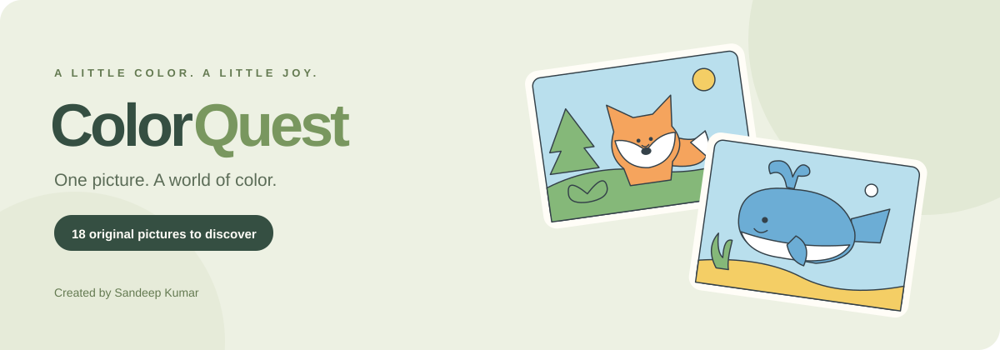
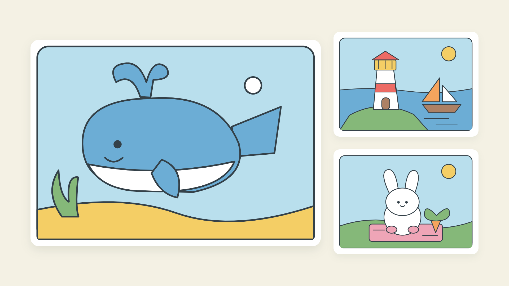

<div align="center">



**A relaxing coloring puzzle, made for little moments of joy.**

Pick a color. Match the reference. Bring a picture to life.

**18 original pictures** &nbsp; · &nbsp; **One colorful journey** &nbsp; · &nbsp; **Phone · Tablet · Desktop**

[**▶ Play ColorQuest**](https://sandeep37-s.github.io/colorquest/) · [Explore the pictures](#a-picture-for-every-mood) · [Run locally](#play-locally) · [Publish the game](#publish-your-own-build) · [Developer guide](docs/DEVELOPMENT.md)

</div>

---

## A little creativity. A little calm.

ColorQuest turns a blank illustration into a small, satisfying adventure. Follow the colored reference, fill each shape, and watch your picture come to life. Earn stars, build your collection, and unlock the next picture—one level at a time.

There’s no timer and no rush. Repaint a shape, ask for a hint, or zoom in on the details whenever you like.



## What makes it fun

| 🎨 Make it colorful | 🗺️ Keep discovering | ✨ Play your way |
| :--- | :--- | :--- |
| 12 selectable paint colors | 18 original interactive pictures | Touch, mouse, and keyboard controls |
| Matching reference for every picture | Levels unlock one by one | Zoom for the little details |
| Instant progress and gentle feedback | Earn up to three stars per picture | Optional numbered color guide |
| Repaint any shape or undo a fill | Revisit your finished favorites | Hints, optional sound, and saved progress |

## A picture for every mood

| Collection | Pictures |
| :--- | :--- |
| 🌿 **First discoveries** | Happy Elephant · Happy Garden · Cute House |
| 🦊 **Woodland trail** | Fox in the Ferns · Bunny’s Picnic · Treetop Owl |
| 🐋 **Ocean days** | Ocean Explorer · Coral Turtle · Lighthouse Bay |
| ⛺ **Outdoor stories** | Mountain Camper · Rainbow Balloon · Sailing Away |
| ☕ **Cozy corners** | Tea on the Terrace · Books and Blooms · Bakery Morning |
| 🚀 **Dream big** | Rocket to the Stars · Castle in the Clouds · Moonlight Music |

## How to play

1. **Choose a color** from the palette.
2. **Paint a shape** to match the reference picture.
3. **Match every shape** to earn stars and unlock the next level.

Made a mistake? Paint over it or use **Undo**. Need a little help? Try **Hint**, **Zoom**, or the **123 Color guide**.

**Keyboard:** use `Tab` to move, `Enter` or `Space` to select and paint, and `Esc` to close a dialog.

## Play locally

You’ll need **Node.js 20.19+ or 22.12+**.

```bash
git clone https://github.com/Sandeep37-s/colorquest.git
cd colorquest
npm ci
npm run dev
```

Open the local address printed in your terminal.

To build and preview the release:

```bash
npm run build
npm run preview
```

The public web build is written to **`dist/`**.

## Publish your own build

| Host | Build command | Publish directory |
| :--- | :--- | :--- |
| **GitHub Pages** | `npm ci && npm run build` in a Pages Actions workflow | `dist` |
| **Vercel** | `npm run build` using the Vite preset | `dist` |
| **Any static host** | `npm run build` locally, then upload the built files | Contents of `dist` |

Assets use relative paths, so the game can run from a repository subdirectory. Hosting the source files alone won’t build the game—you must publish the compiled output.

The public web version saves progress in the current browser. **Live game:** [Play ColorQuest](https://sandeep37-s.github.io/colorquest/). GitHub Pages publishes the game automatically when game changes are pushed to `master`.

<details>
<summary><strong>YouTube Playables integration</strong></summary>

<br>

A separate build includes the official YouTube Playables SDK:

```bash
npm run build:youtube
npm run preview:youtube -- --port 5175
```

The output is **`dist-youtube/`**. In the YouTube environment, the integration handles:

- Loading and game-ready notifications.
- Cloud progress loading and saving, with failure protection and retry.
- Platform audio settings and pause/resume callbacks.
- Versioned saves and restoration of older progress.

The regular public web build and YouTube integration build are separate outputs. Local integration tests use a mock SDK; **official YouTube certification and real-device verification remain pending**.

See the [developer guide](docs/DEVELOPMENT.md) and [local test report](submission/local-test-report.md) for implementation details and remaining checks.

</details>

<details>
<summary><strong>Testing and project structure</strong></summary>

<br>

```bash
npm test
npm run build
npm run build:youtube
npm run check:bundles
```

The latest local verification includes **27 logic, state, and platform tests**, all 18 level completions, touch and keyboard controls, saved progress, responsive layouts, and simulated platform failure recovery. Browser scripts require Microsoft Edge and the appropriate local server; see the [developer guide](docs/DEVELOPMENT.md) for commands.

```text
colorquest/
├── src/             Game logic, original SVG art, styles, and platform adapter
├── public/          Game icon
├── tests/           Game, browser, integration, and bundle checks
├── submission/      Listing drafts, artwork, credits, and verification notes
├── docs/            Project banner and developer guide
├── index.html       Game entry
└── vite.config.js   Web and YouTube build configuration
```

**Built with:** JavaScript, SVG, CSS, Web Audio, and Vite. The public game needs no account, backend, remote fonts, or external image assets.

</details>

---

<div align="center">

**One picture. A world of color.**

Created by **Sandeep Kumar** · [GitHub](https://github.com/Sandeep37-s)

</div>
